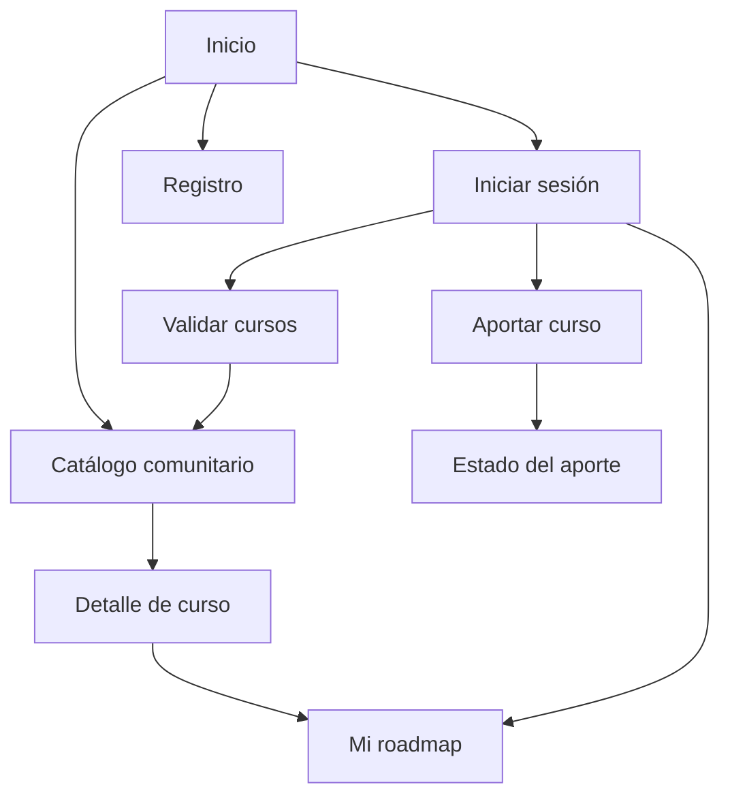

# APPFlow — Mapa del sitio y flujos de usuario — LearnPath

> **Qué es:** el esqueleto de navegación. Sitemap (todas las pantallas y sus rutas), ficha por pantalla y flujos de usuario extremo a extremo. Es el puente entre el PRD (qué quiere el usuario) y el BackendSchema (qué API lo sostiene).
> **Cuándo está bien:** se puede recorrer el producto entero en papel antes de escribir una línea de React; cada pantalla sabe qué API consume, y esas APIs existen en el BackendSchema; no hay ninguna pantalla "colgada" sin ruta ni ningún flujo sin pantallas.

## 1. Sitemap

El catálogo será público, pero para agregar cursos al roadmap
o aportar nuevos cursos será necesario iniciar sesión.
Ademas la validación de cursos estará disponible solamente para administradores.

## 2. Rutas

| Ruta | Pantalla | Requiere login | Notas |
|---|---|---|---|
| `/` | Inicio | No | Página principal |
| `/catalogo` | Catálogo comunitario | No | Listado paginado |
| `/catalogo/:id` | Detalle del curso | No | Información del curso |
| `/login` | Inicio de sesión | No | Acceso a la cuenta |
| `/registro` | Registro | No | Crear una cuenta |
| `/recuperar` | Recuperar contraseña | No | Solicitar recuperación |
| `/restablecer` | Nueva contraseña | No | Requiere token válido |
| `/roadmap` | Mi roadmap | Sí | Cursos personales |
| `/aportar` | Aportar curso | Sí | Formulario de aporte |
| `/aportar/:id/estado` | Estado del aporte | Sí | Consultar revisión |
| `/validar` | Validar cursos | Sí, administrador | Aprobar o rechazar aportes |

## 3. Fichas de pantalla

### Pantalla: Inicio (`/`)

- **Objetivo del usuario:** presentar LearnPath y permitir acceder a sus funcionalidades.
- **Componentes (de la UX-UI):** header, navegación y botones de acceso.
- **Estados:** visualización normal.
- **APIs que consume:** no requiere.
- **Navegación:** catálogo, login y registro.

### Pantalla: Catálogo comunitario (`/catalogo`)

- **Objetivo del usuario:** permitir encontrar cursos gratuitos.
- **Componentes (de la UX-UI):** header, búsqueda, filtros, tarjetas y paginador.
- **Estados:** loading, ok, empty y error.
- **APIs que consume:** `GET /api/v1/cursos`.
- **Navegación:** inicio y detalle del curso.

### Pantalla: Detalle del curso (`/catalogo/:id`)

- **Objetivo del usuario:** consultar la información de un curso.
- **Componentes (de la UX-UI):** título, descripción de datos, enlace y botón para agregar al roadmap.
- **Estados:** loading, ok y error.
- **APIs que consume:** `GET /api/v1/cursos/{id}`.
- **Navegación:** catálogo y roadmap.

### Pantalla: Registro (`/registro`)

- **Objetivo del usuario:** permitir crear una cuenta.
- **Componentes (de la UX-UI):** formulario, campos de datos y botón de registro.
- **Estados:** normal, loading, error y éxito.
- **APIs que consume:** `POST /api/v1/auth/registro`.
- **Navegación:** login.

### Pantalla: Login (`/login`)

- **Objetivo del usuario:** permitir iniciar sesión.
- **Componentes (de la UX-UI):** formulario de correo, contraseña y botón de ingreso.
- **Estados:** normal, loading y error.
- **APIs que consume:** `POST /api/v1/auth/login`.
- **Navegación:** registro, recuperación de contraseña y sección solicitada.

### Pantalla: Recuperar contraseña (`/recuperar`)

- **Objetivo del usuario:** solicitar el restablecimiento de contraseña.
- **Componentes (de la UX-UI):** formulario de correo y botón de envío.
- **Estados:** normal, loading, error y confirmación.
- **APIs que consume:** `POST /api/v1/auth/recuperar`.
- **Navegación:** login.

### Pantalla: Nueva contraseña (`/restablecer`)

- **Objetivo del usuario:** establecer una nueva contraseña.
- **Componentes (de la UX-UI):** formulario de contraseña y confirmación.
- **Estados:** normal, loading, error y éxito.
- **APIs que consume:** `POST /api/v1/auth/restablecer`.
- **Navegación:** login.

### Pantalla: Mi roadmap (`/roadmap`)

- **Objetivo del usuario:** organizar los cursos personales.
- **Componentes (de la UX-UI):** listado de cursos y botones para eliminarlos.
- **Estados:** loading, ok, empty y error.
- **APIs que consume:** `GET /api/v1/roadmap`, `POST /api/v1/roadmap` y `DELETE /api/v1/roadmap/{id}`.
- **Navegación:** catálogo y detalle del curso.

### Pantalla: Aportar curso (`/aportar`)

- **Objetivo del usuario:** permitir compartir un curso gratuito.
- **Componentes (de la UX-UI):** formulario con los campos definidos en la SPEC.
- **Estados:** normal, loading, error y éxito.
- **APIs que consume:** `POST /api/v1/aportes`.
- **Navegación:** estado del aporte.

### Pantalla: Estado del aporte (`/aportar/:id/estado`)

- **Objetivo del usuario:** consultar si un curso fue aprobado, rechazado o sigue pendiente.
- **Componentes (de la UX-UI):** información del curso y estado de revisión.
- **Estados:** loading, ok y error.
- **APIs que consume:** `GET /api/v1/aportes/{id}`.
- **Navegación:** catálogo o aportar curso.

### Pantalla: Validar cursos (`/validar`)

- **Objetivo del usuario:** permitir que un administrador revise los aportes.
- **Componentes (de la UX-UI):** listado paginado y botones para aprobar o rechazar.
- **Estados:** loading, ok, empty y error.
- **APIs que consume:** `GET /api/v1/aportes` y `POST /api/v1/aportes/{id}/validar`.
- **Navegación:** catálogo.

## 4. Flujos de usuario

### Flujo 1 — Aportar un curso

1. El usuario inicia sesión.
2. Selecciona la opción "Aportar curso".
3. Completa el formulario con la información solicitada.
4. Indica si realizó el curso o no.
5. Presiona el botón para enviar el aporte.
6. El sistema valida los campos obligatorios.
7. Si los datos son correctos, se guarda el aporte con estado "en revisión".
8. Se muestra un mensaje de confirmación.
9. El usuario puede consultar el estado de su aporte.

**Errores posibles:**
- Si faltan datos, se muestran los campos que debe completar.
- Si el enlace no tiene un formato válido, se informa el error.
- Si falla la conexión, se permite intentar nuevamente.

### Flujo 2 — Agregar un curso al roadmap

1. El usuario ingresa al catálogo.
2. Busca un curso que le interese.
3. Selecciona el curso para ver su información.
4. Presiona "Agregar a mi roadmap".
5. Si no inició sesión, es dirigido al login.
6. Si tiene sesión, el curso se agrega a su roadmap.
7. Se muestra una confirmación.
8. El usuario puede consultar sus cursos desde "Mi roadmap".

**Errores posibles:**
- Si el curso no existe, se muestra un mensaje.
- Si falla la conexión, se informa al usuario.
- Si el curso ya está agregado, se evita duplicarlo.

### Flujo 3 — Validar un curso

1. El administrador inicia sesión.
2. Ingresa a la sección "Validar cursos".
3. Consulta los aportes pendientes.
4. Selecciona un curso.
5. Revisa la información ingresada.
6. Decide aprobar o rechazar el aporte.
7. Si lo aprueba, el curso aparece en el catálogo comunitario.
8. Si lo rechaza, el aporte no se publica y se informa su estado.

**Errores posibles:**
- Si el usuario no es administrador, no puede acceder.
- Si ocurre un problema al guardar la decisión, se muestra un mensaje de error.

## 5. Estados globales de la aplicación

| Situación | Comportamiento |
|---|---|
| Usuario sin sesión en una ruta protegida | Se redirige al login. |
| Sesión expirada | Se informa al usuario y se solicita iniciar sesión nuevamente. |
| Error de conexión | Se muestra un mensaje y la opción de reintentar. |
| Listado sin resultados | Se muestra un mensaje indicando que no hay cursos disponibles. |
| Usuario sin permisos | Se impide el acceso a la sección solicitada. |

---

## Referencias
- NN/g — Information Architecture vs. Sitemaps: https://www.nngroup.com/articles/information-architecture-sitemaps/
- NN/g — User Journeys vs. User Flows: https://www.nngroup.com/articles/user-journeys-vs-user-flows/
