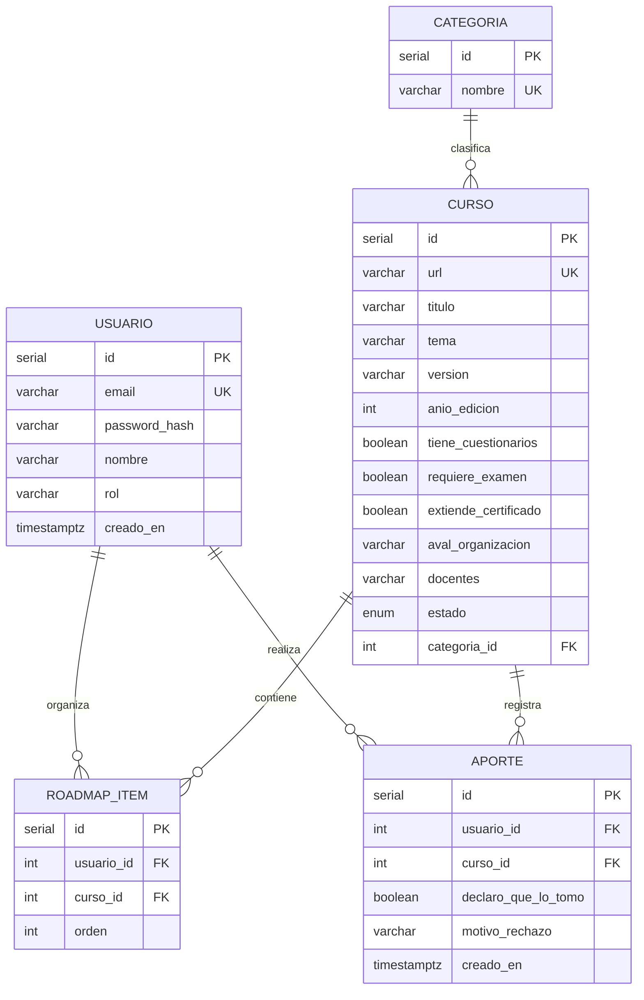
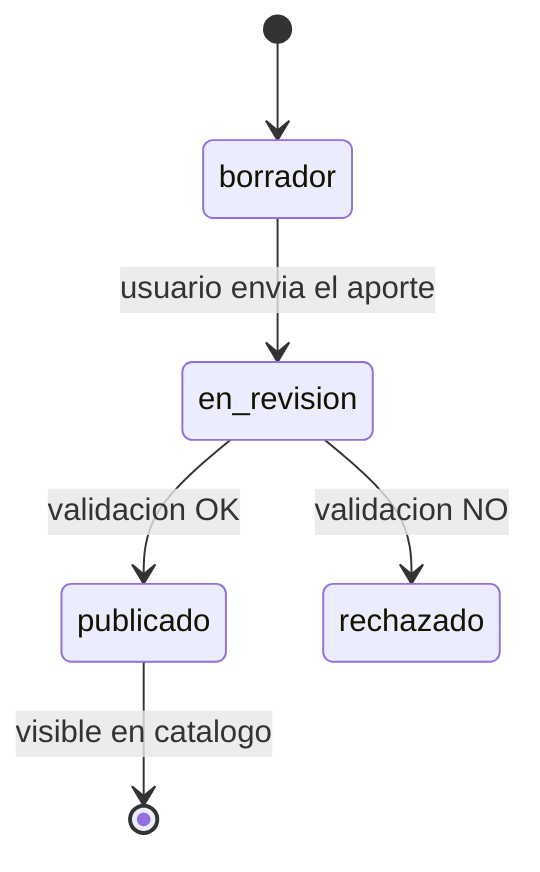

# BackendSchema — Esquema de base de datos y APIs — LearnPath

> **Qué es:** el contrato del backend: modelo de datos en PostgreSQL + superficie de API REST. Es lo que hace posible el TRD y lo que consume el APPFlow.
> **Cuándo está bien:** con este documento se puede crear la base de datos y escribir los tests de integración sin tomar decisiones de diseño pendientes; todo endpoint que aparece en el APPFlow existe acá con sus respuestas y errores; los estados del curso están modelados.

## 1. Modelo de datos

### 1.1 Diagrama entidad-relación



### 1.2 Tablas

#### `usuarios`

| Columna | Tipo | Constraints | Notas |
|---|---|---|---|
| id | serial | PK | Identificador |
| email | varchar(255) | UNIQUE NOT NULL | Correo del usuario |
| password_hash | varchar(255) | NOT NULL | Contraseña protegida |
| nombre | varchar(100) | NOT NULL | Nombre del usuario |
| rol | varchar(20) | NOT NULL | usuario o administrador |
| creado_en | timestamptz | NOT NULL | Fecha de registro |

**Índices:** email único para evitar usuarios duplicados.

#### `categorias`

| Columna | Tipo | Constraints | Notas |
|---|---|---|---|
| id | serial | PK | Identificador |
| nombre | varchar(100) | UNIQUE NOT NULL | Nombre de categoría |

**Índices:** nombre único para evitar categorías repetidas.

#### `cursos`

| Columna | Tipo | Constraints | Notas |
|---|---|---|---|
| id | serial | PK | Identificador |
| url | varchar(2048) | UNIQUE NOT NULL | Enlace del curso |
| titulo | varchar(200) | NOT NULL | Título |
| tema | varchar(200) | NOT NULL | Tema |
| version | varchar(50) | NOT NULL | Versión |
| anio_edicion | int | NOT NULL | Año |
| docentes | varchar(500) | NOT NULL | Docentes |
| tiene_cuestionarios | boolean | NOT NULL | Sí o no |
| requiere_examen | boolean | NOT NULL | Sí o no |
| extiende_certificado | boolean | NOT NULL | Sí o no |
| aval_organizacion | varchar(200) | NULL | Organización, si corresponde |
| categoria_id | int | FK NOT NULL | Categoría |
| estado | estado_curso | NOT NULL | Estado del curso |

**Índices:** URL única para evitar cursos repetidos y categoría para facilitar el filtrado.

#### `aportes`

| Columna | Tipo | Constraints | Notas |
|---|---|---|---|
| id | serial | PK | Identificador |
| usuario_id | int | FK NOT NULL | Usuario que aporta |
| curso_id | int | FK NOT NULL | Curso aportado |
| declaro_que_lo_tomo | boolean | NOT NULL | Declaración del usuario |
| motivo_rechazo | varchar(500) | NULL | Motivo, si se rechaza |
| creado_en | timestamptz | NOT NULL | Fecha del aporte |

**Índices:** usuario_id y curso_id para consultar los aportes.

#### `roadmap_items`

| Columna | Tipo | Constraints | Notas |
|---|---|---|---|
| id | serial | PK | Identificador |
| usuario_id | int | FK NOT NULL | Propietario |
| curso_id | int | FK NOT NULL | Curso agregado |
| orden | int | NOT NULL | Posición en el roadmap |

**Restricción:** UNIQUE(usuario_id, curso_id), para evitar agregar el mismo curso dos veces.

**Índices:** usuario_id para consultar el roadmap personal.

## 2. Estados del ciclo de vida del curso



| Estado | Quién lo ve | Qué puede pasar |
|---|---|---|
| borrador | Autor | Enviar a revisión |
| en_revision | Autor y administrador | Aprobar o rechazar |
| publicado | Todos | Agregar al roadmap |
| rechazado | Autor y administrador | Consultar el motivo |

Los cursos enviados desde el formulario ingresarán directamente en estado `en_revision`. El estado `borrador` queda definido para el ciclo de vida, pero no se implementará una pantalla de borradores en la primera versión.

## 3. API REST

**Convenciones generales:**

- Prefijo: `/api/v1`.
- Paginación mediante `page` y `page_size`.
- Respuestas paginadas con `items`, `total`, `page` y `page_size`.
- Errores con código y mensaje.
- Fechas en formato ISO 8601 UTC.

Ejemplo de error:

```json
{
  "error": {
    "code": "CURSO_NO_ENCONTRADO",
    "message": "El curso solicitado no existe"
  }
}
```

### 3.1 Autenticación

| Método | Path | Auth | Request | Respuestas |
|---|---|---|---|---|
| POST | `/api/v1/auth/registro` | Pública | email, password, nombre | 201, 409, 422 |
| POST | `/api/v1/auth/login` | Pública | email, password | 200, 401, 429 |
| POST | `/api/v1/auth/logout` | Sesión | — | 204 |
| POST | `/api/v1/auth/recuperar` | Pública | email | 200 |
| POST | `/api/v1/auth/restablecer` | Pública | token, nueva_password | 200, 400 |

Las contraseñas se almacenarán mediante bcrypt como mínimo.

El login tendrá rate limiting. Las solicitudes de recuperación utilizarán un token temporal de un solo uso, almacenado de forma segura.

### 3.2 Catálogo de cursos

| Método | Path | Auth | Query / Request | Respuestas |
|---|---|---|---|---|
| GET | `/api/v1/cursos` | Pública | page, page_size, categoria, q | 200 paginado, 422 |
| GET | `/api/v1/cursos/{id}` | Pública | — | 200, 404 |

Ejemplo de respuesta:

```json
{
  "items": [
    {
      "id": 1,
      "titulo": "Introducción a Python",
      "categoria": {
        "id": 1,
        "nombre": "Programación"
      },
      "estado": "publicado"
    }
  ],
  "total": 1,
  "page": 1,
  "page_size": 20
}
```

El catálogo solamente mostrará cursos publicados.

### 3.3 Aportes de cursos y validación

| Método | Path | Auth | Request | Respuestas |
|---|---|---|---|---|
| POST | `/api/v1/aportes` | Sesión | Datos del curso y declaración | 201, 409, 422 |
| GET | `/api/v1/aportes/{id}` | Autor | — | 200, 403, 404 |
| GET | `/api/v1/aportes` | Administrador | page, page_size | 200 paginado, 403 |
| POST | `/api/v1/aportes/{id}/validar` | Administrador | aprobado, motivo_rechazo | 200, 403, 404 |

Los aportes aprobados pasarán al catálogo comunitario.

Los rechazados conservarán el motivo del rechazo y no se publicarán.

### 3.4 Roadmap del usuario

| Método | Path | Auth | Request | Respuestas |
|---|---|---|---|---|
| GET | `/api/v1/roadmap` | Sesión | page, page_size | 200 paginado |
| POST | `/api/v1/roadmap/items` | Sesión | curso_id, orden | 201, 409, 404 |
| DELETE | `/api/v1/roadmap/items/{id}` | Sesión | — | 204, 403, 404 |

Cada usuario podrá consultar y modificar únicamente su propio roadmap.

Solo se podrán agregar cursos publicados.

### 3.5 Categorías

| Método | Path | Auth | Respuestas |
|---|---|---|---|
| GET | `/api/v1/categorias` | Pública | 200 |

Las categorías estarán definidas en una lista cerrada.

## 4. Decisiones del esquema

| Decisión | Alternativas | Por qué |
|---|---|---|
| Categorías en tabla propia | Tabla o enum | Permite relacionarlas con los cursos mediante una clave foránea. |
| Roadmap mediante tabla intermedia | Tabla intermedia o guardar cursos directamente en usuario | Permite que distintos usuarios agreguen el mismo curso sin duplicar sus datos. |
| Características del curso como booleanos | Booleanos o JSONB | Son datos de sí/no y resultan sencillos de consultar. |

---

## Referencias
- Mermaid — Entity Relationship Diagrams: https://mermaid.js.org/syntax/entityRelationshipDiagram.html
- PostgreSQL — The Conceptual Model (tablas, constraints, índices): https://www.postgresql.org/docs/current/datamodel.html
