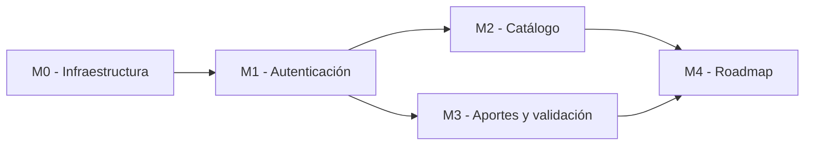

# Implementation Plan — LearnPath

> **Qué es:** el orden de construcción. Módulos, dependencias, tareas con su definición de hecho y estimaciones. Es lo que ejecutás en la Instancia B, tarea por tarea, rama por rama.
> **Cuándo está bien:** cada tarea tiene un "hecho" verificable sin interpretaciones; el orden respeta dependencias reales; el MVP está definido sin ambigüedades — se puede responder con un sí o un no a la pregunta "¿el lunes a la noche funciona esto?".

## 1. MVP — qué es P0

> Criterio de MVP: en una máquina limpia, `docker compose up` y recorrer end-to-end las siguientes historias del PRD, sin errores en consola:

- US-001: Registro de usuarios.
- US-002: Inicio de sesión.
- US-003: Consulta del catálogo comunitario.
- US-004: Aporte de cursos.

También será necesario contar con la validación de cursos y el roadmap personal para completar el funcionamiento principal de la aplicación.

El MVP deberá permitir realizar estas acciones sin errores en la consola.

## 2. Módulos y dependencias

Se organizará el desarrollo en cinco módulos.

Primero se configurará el proyecto. Después se implementarán los usuarios y las funcionalidades relacionadas con los cursos.

## 3. Detalle por módulo

### M0 — Scaffold e infraestructura

| # | Tarea | Hecho cuando... | Estimación |
|---|---|---|---|
| 0.1 | Crear la estructura de carpetas del TRD | Las carpetas están creadas correctamente. | 30 min |
| 0.2 | Configurar Docker Compose con PostgreSQL 18.6 | PostgreSQL inicia y acepta conexiones. | 45 min |
| 0.3 | Crear backend mínimo con FastAPI | `GET /health` responde 200. | 1 h |
| 0.4 | Crear frontend con React 19 y Vite | `pnpm dev` inicia la aplicación. | 1 h |

### M1 — Autenticación

| # | Tarea | Hecho cuando... | Estimación |
|---|---|---|---|
| 1.1 | Crear tabla de usuarios | Los usuarios se pueden guardar en PostgreSQL. | 1 h |
| 1.2 | Implementar registro | Se puede registrar un usuario con datos válidos. | 2 h |
| 1.3 | Implementar login y logout | El usuario puede iniciar y cerrar sesión. | 2 h |
| 1.4 | Implementar bcrypt y rate limiting | Las contraseñas se protegen y se limitan los intentos de login. | 2 h |
| 1.5 | Implementar recuperación de contraseña | Se puede solicitar un enlace o token y establecer una nueva contraseña. | 2 h |

### M2 — Catálogo comunitario

| # | Tarea | Hecho cuando... | Estimación |
|---|---|---|---|
| 2.1 | Crear categorías y cursos de prueba | Existen datos disponibles para consultar. | 1 h |
| 2.2 | Implementar API de cursos | `GET /api/v1/cursos` devuelve cursos paginados. | 2 h |
| 2.3 | Crear pantalla de catálogo | Se muestran las tarjetas y el paginador. | 2 h |
| 2.4 | Crear detalle del curso | Se puede consultar la información de un curso. | 1 h |

### M3 — Aportes y validación

| # | Tarea | Hecho cuando... | Estimación |
|---|---|---|---|
| 3.1 | Crear formulario de aporte | Se pueden completar los datos del curso. | 2 h |
| 3.2 | Implementar API de aportes | Los cursos se guardan pendientes de validación. | 2 h |
| 3.3 | Implementar validación | Un administrador puede aprobar o rechazar un curso. | 2 h |
| 3.4 | Mostrar estado del aporte | El usuario puede consultar el resultado de la revisión. | 1 h |

### M4 — Roadmap personal

| # | Tarea | Hecho cuando... | Estimación |
|---|---|---|---|
| 4.1 | Crear tabla del roadmap | Se pueden relacionar usuarios con cursos. | 1 h |
| 4.2 | Implementar API del roadmap | Se pueden agregar, consultar y eliminar cursos. | 2 h |
| 4.3 | Crear pantalla del roadmap | El usuario puede visualizar y gestionar sus cursos. | 2 h |

Las estimaciones son aproximadas y podrán ajustarse durante el desarrollo.

## 4. Ejecución (Instancia B)

Cada tarea o grupo de tareas relacionadas se realizará en una rama de Git.

Los cambios se registrarán mediante Conventional Commits.

| # | Tarea | Módulo | Estado | Rama / Commit |
|---|---|---|---|---|
| 0.1 | Estructura de carpetas | M0 | Pendiente | — |
| 0.2 | Configuración PostgreSQL | M0 | Pendiente | — |
| 0.3 | Backend inicial | M0 | Pendiente | — |
| 0.4 | Frontend inicial | M0 | Pendiente | — |
| 1.1 - 1.5 | Autenticación | M1 | Pendiente | — |
| 2.1 - 2.4 | Catálogo | M2 | Pendiente | — |
| 3.1 - 3.4 | Aportes y validación | M3 | Pendiente | — |
| 4.1 - 4.3 | Roadmap | M4 | Pendiente | — |

## 5. Estrategia de testing

> Se **planificá** acá y se **implementa** en la clase del 27/10.

- **Unit tests (services):** funciones puras de negocio — ej. reglas de validación de aportes, reglas del roadmap, transiciones de estado del curso. Patrón AAA, sin BD ni HTTP.
- **Integration tests (repositories/services):** contra BD real (SQLite en memoria o Postgres del compose).
- **Frontend:** hooks con Vitest (estado de carga, paginación, errores).
- Objetivo de cobertura: [declará el tuyo — ej. ≥ 85% en services]

## 6. Riesgos del plan

| Riesgo | Impacto | Mitigación |
|---|---|---|
| Problemas al configurar Docker | Alto | Verificar cada servicio por separado. |
| Errores de conexión con PostgreSQL | Alto | Comprobar la configuración y las variables de entorno. |
| Dificultades con la autenticación | Alto | Implementar y probar cada operación por separado. |
| Tiempo insuficiente para completar las funcionalidades | Alto | Priorizar el MVP y avanzar por módulos. |

---

## Referencias
- Atlassian — Plantilla de plan de proyecto: https://www.atlassian.com/software/confluence/templates/project-plan
- Shape Up — cómo partir trabajo real en scopes cerrables: https://basecamp.com/shapeup/